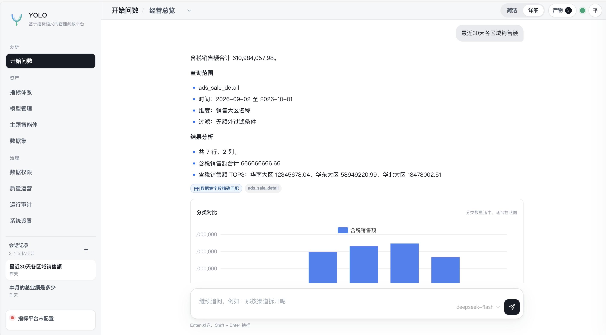
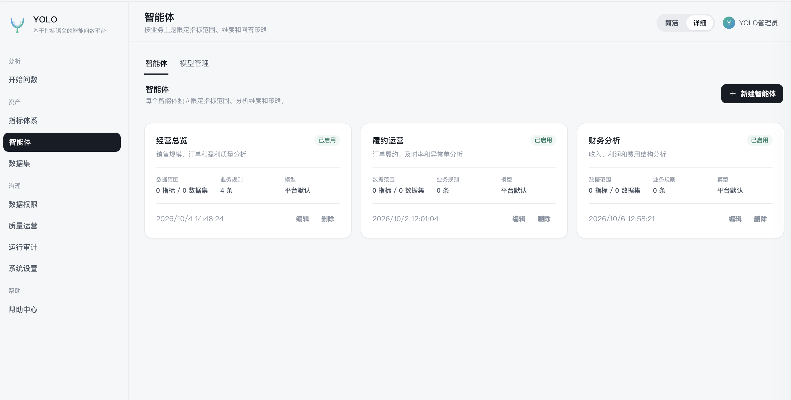
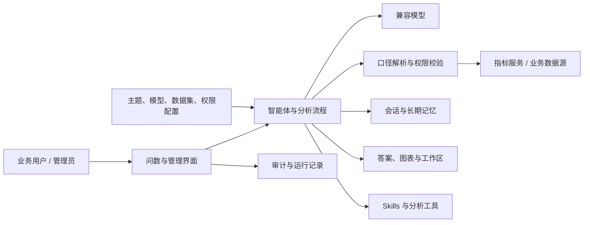

[English](README_EN.md) | 简体中文

# YOLO Data Agent｜企业级智能问数平台

面向业务团队的自助数据分析平台：用自然语言提问，从统一口径的数据中获得可追溯的结果，并在同一会话里继续拆解、对比和分析。

YOLO Data Agent把智能体、指标和业务数据集、权限及分析工作区连成一条可管理的问数流程。业务人员不必编写 SQL：可以直接提问、补充条件、追问结果；遇到关键信息不明确时，智能体会先请求澄清。管理员则负责接入数据、配置业务主题与授权范围，让团队在可控的数据边界内开展分析。

平台不会把“模型生成一段 SQL”当作分析结果：查询范围、指标口径和权限由平台配置并在执行时校验；结果、会话和分析产物可以留存，便于继续工作与审计。

## 与通用 Agent 有什么不同

通用 Agent 通常面向开放任务，通过模型临场选择工具和行动；YOLO Data Agent 聚焦企业数据分析，把模型能力放进管理员配置的业务语义、数据范围和执行规则中。模型负责理解问题、组织分析与解释结果，平台负责决定“能查什么、按什么口径查、结果如何执行”。

| 对比维度 | 通用 Agent 常见方式 | YOLO Data Agent |
| --- | --- | --- |
| 任务范围 | 面向开放任务，按提示词和可用工具灵活行动 | 围绕业务主题、指标和获准数据集开展问数与分析 |
| 数据理解 | 可能直接依赖模型阅读 schema、猜测字段含义 | 管理员配置字段语义、指标口径、默认值域和主题范围 |
| 查询执行 | 可能由模型生成并调用 SQL 或其他数据工具 | Contract-first：模型提出结构化查询意图，平台校验并编译只读查询；模型不提交原始 SQL |
| 权限边界 | 常由提示词、工具配置或上游系统承担 | 主题/指标/数据集授权及行列策略在服务端执行 |
| 结果延续 | 依赖通用对话上下文和临时工具结果 | 会话记忆、结果快照、工作区产物、反馈和审计连接成可复查的分析流程 |

因此，YOLO Data Agent 不是要替代所有通用 Agent 场景，而是为“数据口径需要统一、访问需要治理、结论需要追溯”的业务分析任务提供专用执行框架。Skills 和 MCP 扩展接入方式，但不会绕过平台的数据权限与查询校验。

## 你可以用 YOLO Data Agent做什么

- **直接问业务问题**：例如“近 30 天各渠道销售额趋势如何？”或“哪些区域本月下降最多？”。支持连续追问、对比、拆分、排行及结果解释。
- **使用统一业务口径**：由管理员配置指标、字段含义、默认时间范围和主题示例，减少同一指标在不同问题中的口径偏差。
- **分析获准的数据**：每个智能体可配置可用指标、数据集、模型和 Skills；主题、数据集、行及列权限在平台侧执行。
- **从结果继续工作**：会话记忆帮助承接上下文；表格、图表、文件和代码分析结果可保留在工作区，方便下载、复查和后续追问。
- **管理和复盘使用情况**：管理员可查看查询计划、数据集访问记录、模型调用、反馈和知识缺口，定位配置问题并持续改进。

### 登录与会话

#### 在线演示

- 演示地址：[http://49.232.39.8/](http://49.232.39.8/)
- 演示账号：`admin` / `yolo123456`

## 页面截图

 

 




## 核心能力

- **指标与业务数据集**：对接指标目录，或连接 MySQL、TiDB、Doris、PostgreSQL。字段语义经过配置后用于生成只读查询；模型不会直接提交原始 SQL。支持字段同步、抽样、默认值域和查询审计。
- **按业务配置的智能体**：每个主题可独立配置提示词、模型、Skills、指标和数据集范围、默认口径与示例问题，适配不同团队的分析场景。
- **稳定的分析过程**：平台将问题解析为受控查询条件，在执行前校验数据范围和权限，并由平台处理时间范围、排序及结果整理；复杂问题支持分组、时间趋势、派生计算、筛选和 Top-N。
- **数据访问控制**：管理员可配置主题、指标和数据集授权，以及行级策略和列隐藏/脱敏。权限在服务端查询执行阶段生效，而不是只依赖页面隐藏。
- **连续对话与工作区**：会话按用户和主题隔离，支持上下文记忆和长期记忆；表格、图表、文件及代码分析结果可保留为工作区产物，追问时可复用已有结果。
- **可扩展 Skills**：公共 Skills 可由管理员上传、启停、删除和管理引用；Skills 可参与规划约束、执行前审计与结果验证。详见 [Skill 上传与验收](docs/skill-upload.md)。
- **审计与运维**：支持流式执行状态、查询计划、模型 Token 用量、反馈和知识缺口，便于管理员排查与改进口径。
- **MCP 接入**：通过 Streamable HTTP `/mcp` 提供指标发现、权限读取、快照读取、查询解析和执行工具；查询遵循“先解析、再执行”。详见 [MCP 连接器](mcp-connector/README.md)。
- **部署安全能力**：支持会话登录、提示注入清洗、每日 Token 预算，以及 Docker/Podman + seccomp 代码执行隔离。默认 `inprocess` 只适合可信环境；多租户部署应配置容器沙箱。

## 核心工作流

```text
业务问题 → 主题与语义识别 → 结构化查询契约 → 字段/时间/权限校验
         → 指标或只读数据集执行 → 稳定结果与解释 → 记忆、工作区、反馈和审计
```

这条流程的关键是“模型提议，平台裁决”：模型可以帮助理解和规划，但查询契约、授权范围和执行结果由平台规则控制。


## 工作方式

一次问数通常经过以下步骤：




## 如何开始

部署并完成初始化后，建议按下面顺序配置：

1. **配置模型**：在“模型管理”中添加可用的 OpenAI 兼容模型，并选择平台或主题默认模型。
2. **接入数据**：接入指标服务，或在“数据集管理”配置 MySQL、TiDB、Doris、PostgreSQL 数据源并同步字段。
3. **整理业务语义**：为数据集字段设置业务名称、指标/维度/时间角色及聚合方式；也可以使用“智能识别”生成建议后由管理员确认。
4. **配置智能体与权限**：按业务主题配置提示词、数据范围、模型、Skills 和用户授权。先用管理员账号验证，再授权给业务用户。
5. **开始问数**：进入问数页面，选择主题后用自然语言提问；需要时继续追问或将结果保存到工作区。

普通用户只会看到已授权的智能体和数据范围；具体可用能力取决于管理员的模型、数据与权限配置。


## 业务规则与提示词设置

提示词可用于定义分析表达方式；业务词、枚举映射、计算公式和默认口径应放在：

- 主题提示词，参考docs/theme-prompts/sales-operation.md
- 数据集字段说明
- 默认值域配置


## 环境要求

- Node.js `>= 22.5`
- 平台配置： MySQL（默认）或SQLite；通过 `PLATFORM_DB_BACKEND` 选择。MySQL 模式还需配置 `PLATFORM_DB_*`相关参数。
- npm 或 pnpm
- Python 3.11+： 必须是python3.11以上，用于高级数据处理和文件生成。`npm run setup` 会自动初始化环境
- 或：Docker + Docker Compose，一条命令启动完整平台，无需本机 Node/Python（见 [Docker 一键部署](#docker-一键部署)）
- 可选外部服务：
  - Doris 或 MySQL 兼容业务数据库
  - DeepSeek 或其他 OpenAI 兼容模型服务

## 快速部署

### 方式一：启动脚本（Linux / Windows）

```bash
git clone https://github.com/xiaour/yolo-data.git yolo-data
cd yolo-data
./start.sh
```
Windows PowerShell 运行 `./start.ps1`。启动脚本会引导完成首次初始化，之后再次运行即可启动。

### 方式二：Docker Compose

```bash
docker compose up -d --build
```

服务启动后访问 [http://localhost:8088/](http://localhost:8088/)。按需在 `yolo-conf.yaml` 中配置模型和数据源；首次登录后请修改默认口令。详细配置见下方配置说明。

本机账号、密码和 API Key 建议放在 `.env`（从 `.env.example` 复制），不要提交；优先级为进程环境变量 > `.env` > `yolo-conf.yaml`。

PostgreSQL 数据源接入方式见 [PostgreSQL 接入文档](docs/postgresql.md)。


## 配置说明

### 配置文件 `yolo-conf.yaml`

根目录的 `yolo-conf.yaml` 是配置文件，字段说明见文件内注释。

### OpenAI 兼容模型（推荐 DeepSeek）

- 智能体可以选择一个或多个模型，并指定默认模型。

### 业务数据集
支持 MySQL、Doris、PostgreSQL以及TiDB数据源（需安装可选驱动 `pg`，参见 [PostgreSQL 接入](docs/postgresql.md)）。查询由平台根据字段语义编译，模型不会直接提交原始 SQL。

#### 数据集智能识别

数据集列表的「智能识别」入口会自动推断字段角色（`TIME/METRIC/DIMENSION/IDENTIFIER`）、  
聚合方式与默认时间窗口，管理员逐项确认后写回既有配置面，减少问数时的口径与时间范围追问。

#### 字段启用与禁用

「字段」弹窗支持逐个字段启用/禁用，**默认全部启用**。数据集列表与「智能体 → 数据范围」共用同一入口，  
两边修改的是同一份配置。agent 与查询链路统一按启用读取字段，禁用字段不可作为维度/指标/时间字段或筛选条件。  
「同步结构」会保留禁用状态。

### 内置演示数据（Demo）

`config/demo/` 自带一套「供应链销售明细」演示数据。
开启开关后，服务启动时会依次完成Demo数据初始化。

```yaml
# yolo-conf.yaml
bootstrapDatasource:
  demo:
    enabled: true
```

- **数据落在哪个库**：默认复用平台 MySQL 数据源 `platform_mysql`（需 `platformDatabase.backend: mysql`）；
也可以在 `bootstrapDatasource.demo.db` 中单独指定 MySQL 或 Doris 数据源。详细选项和平台配置快照说明见 [Demo 文档](config/demo/README.md)。

## API 示例

### 流式问数

```bash
curl -N -X POST http://localhost:8088/api/chat/query/stream \
  -H 'Content-Type: application/json' \
  -b cookie.txt \
  -d '{
    "themeId": 1,
    "question": "8月各渠道销售额环比变化如何？"
  }'
```

## 安全与治理

- 对外部署前必须先打开会话鉴权。
- 不向模型暴露原始 SQL。
- 数据集查询使用平台自有只读查询构建器。
- 行级权限在执行层强制生效，列级权限在浏览器返回前执行。
- 数据源密码和模型密钥加密保存。
- 关键操作写入审计日志。
- 上传文件进入模型上下文前默认执行提示注入清洗。
- 可设置每日 Token 上限。
- 当前应用支持 `AUTH_MODE=dev` / `session`；对外部署使用 `session`。OIDC/JWT 模块尚未接入应用鉴权流程，`AUTH_MODE=oidc` 会阻止启动。

## 生产化注意事项

- `docker compose up -d` 默认使用 `AUTH_MODE=session` 且仅绑定 `127.0.0.1`。对外部署仍必须修改默认口令，并在 HTTPS 反向代理后运行；`NODE_ENV=production` 下直接用 HTTP 访问会因 Secure Cookie 导致登录失败。
- 代码执行默认 `SANDBOX_BACKEND=inprocess`，这不是安全边界。不可信用户场景应配置 Docker/Podman 容器、seccomp、无网络和只读根文件系统。
- 平台状态可选择 SQLite 或 MySQL（`PLATFORM_DB_BACKEND=sqlite|mysql`）；SQLite 适合单机/轻量部署，MySQL 适合希望将平台配置与业务服务统一运维的环境。

## 相关文档

- [系统架构](docs/architecture.md)
- [长期记忆架构](docs/memory-architecture.md)
- [PostgreSQL 接入](docs/postgresql.md)
- [MCP 连接器](mcp-connector/README.md)

## 参与贡献

欢迎参与贡献，请保持以下边界：

- 业务特定映射不要写入平台核心代码。
- 保持 Contract-first【契约先行】 执行和权限强制。
- 文件体积只降不升，不要静默抬高基线。
- 新工作流或回归修复应补充对应测试。
- 不要从本仓库修改外部指标平台项目。

更详细的设计说明请查看 [docs/architecture.md](docs/architecture.md)。

## 许可证

Apache License 2.0 详见 [LICENSE](LICENSE)。
