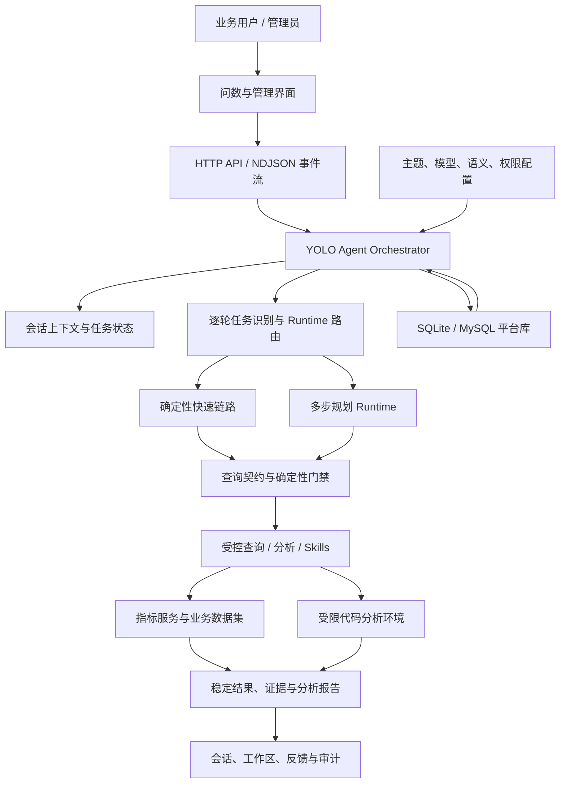
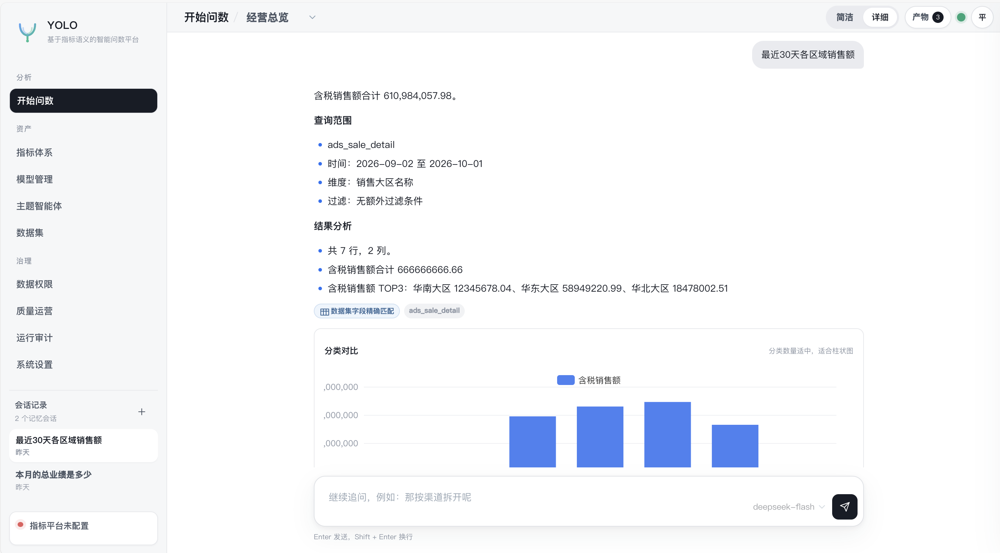
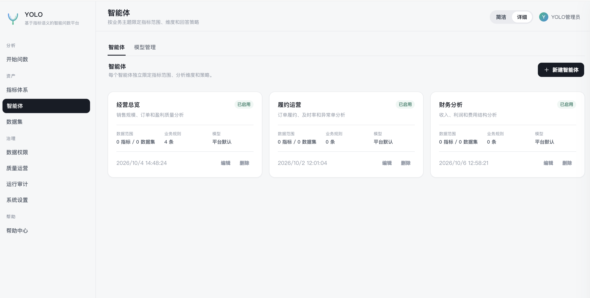

[English](README_EN.md) | 简体中文

# YOLO Data Agent｜企业级智能问数与分析平台

YOLO Data Agent 面向需要统一业务口径、控制数据权限并保留分析证据的团队。用户可以直接用自然语言问数、追问、拆解和分析；管理员负责配置业务主题、指标、数据集、模型、Skills 与权限边界。

平台不把“大模型生成了一段 SQL”视为可靠答案。模型负责理解问题、提出计划和解释结果；YOLO 负责确认上下文、编译查询契约、执行权限、生成只读查询、锁定结果并保存证据。

## 设计目标

- **让业务问题可执行**：把自然语言转成明确的指标、维度、时间、筛选、排序和分析目标。
- **让查询口径可治理**：业务词、指标定义、字段角色、枚举值域和默认规则由平台配置，不依赖模型临场猜测。
- **让数据访问可控制**：主题、指标、数据集及行列权限在服务端执行，不能通过提示词绕过。
- **让结果可复查**：保存查询契约、执行计划、结果指纹、数据 Hash、工作区产物和审计记录。
- **让简单问题足够快、复杂问题能够拆解**：每轮独立判断执行路径，不把整个会话锁死在某一种计算模式。

## 核心设计原则

### 1. YOLO 会话是唯一上下文事实源

会话消息、任务状态、继承条件、澄清结果、权限和工作区产物统一由 YOLO 管理。每一轮执行都会形成版本化上下文，任何模型或规划线程都不能自行决定是否继承上一轮的指标、时间或筛选条件。

这使“按省区分组呢”“换成今年”“只看华东”等追问能够基于明确的任务状态继续，而不是依赖模型猜测聊天历史。

### 2. Contract-first：先形成契约，再访问数据

模型只提交结构化查询意图。平台将其编译为查询契约，并在执行前校验：

- 指标、维度和字段是否存在且已启用；
- 时间范围和聚合粒度是否明确；
- 枚举值和业务规则是否有可追溯来源；
- 当前用户是否拥有主题、数据集、行和列权限；
- 查询是否满足只读、限行和稳定排序要求。

契约未通过时不会执行数据查询，也不会用相近字段拼凑答案。

### 3. 模型提议，平台裁决

模型适合处理语义理解、任务规划、分析方法选择和业务表达；时间计算、权限合并、字段白名单、SQL 编译、数值计算和结果验证由确定性代码完成。所有数字必须来自成功执行并锁定的数据结果。

### 4. 逐轮路由，而不是会话级模式绑定

简单问数优先走低延迟确定性链路；复杂对比、归因、诊断、报告和代码分析进入多步规划链路。路由每轮重新判断，已有规划线程不会强制后续简单问题继续走复杂路径；中间发生的快速问数会在下一次复杂分析时补入规范上下文。

### 5. Workflow 是执行投影，不是固定流水线

平台定义 14 个标准阶段，作为 Runtime、门禁、Skills、审计和页面展示的共同语言，但不会要求每个问题机械执行全部阶段。页面只展示本轮真实发生的步骤，Skills 也只在对应阶段参与规划、执行或结果验证。

### 6. 结果优先于叙述

查询结果先形成稳定快照，再生成自然语言回答、图表或分析报告。追问和结果操作优先复用锁定快照，避免没有必要的重复查询造成数字漂移。

## 总体架构



### 架构分层

| 层级 | 主要职责 |
| --- | --- |
| 体验层 | 问数、连续追问、澄清、图表、Markdown 报告和工作区文件 |
| Agent 编排层 | 上下文解析、逐轮路由、工具编排、异常恢复、反思与回答生成 |
| 语义与治理层 | 业务词、指标口径、字段角色、值域、查询契约、权限和门禁 |
| 执行层 | 指标查询、数据集只读查询、派生计算、代码分析和结果验证 |
| 持久化层 | 用户、主题、会话、任务状态、工作区、审计和平台配置 |

复杂任务的多步规划可以由项目内置的开源 Runtime 承担；它只是 Agent 编排层的一个可替换执行组件。YOLO 会话、查询契约、权限和结果证据始终由平台掌控。

## 一轮问数如何执行

```text
用户问题
  → 读取 YOLO 会话、长期记忆和主题配置
  → 识别新问题、追问、结果操作或口径澄清
  → 选择快速链路或多步规划链路
  → 解析指标、维度、时间和业务筛选
  → 编译并校验查询契约
  → 通过受控工具执行只读查询或分析
  → 锁定结果并生成图表、回答或分析报告
  → 保存任务状态、工作区产物和审计证据
```

同一会话的查询、异常恢复和执行后反思共用会话锁，避免并发请求交叉写入消息、任务状态或工作区产物。

## 核心能力

- **业务智能体**：每个主题独立配置提示词、模型、Skills、指标、数据集、默认口径和示例问题。
- **指标与业务数据集**：支持指标目录以及 MySQL、TiDB、Doris、PostgreSQL 数据源。
- **字段语义治理**：维护字段业务名、角色、聚合方式、值域、别名、默认时间字段和启用状态。
- **连续分析**：支持追问、分组、排行、趋势、同比环比、占比、派生指标、归因和机会点分析。
- **分析报告与工作区**：查询结果、Markdown 报告、图表、CSV、JSON、XLSX 和代码产物可持续复用。
- **权限控制**：支持主题、指标、数据集授权，以及行级过滤和列隐藏/脱敏。
- **Skills 与 MCP**：扩展规划规范、结果验证和外部查询能力，但不能绕过契约与权限。
- **可观测性**：记录动态 Workflow、工具调用、模型调用、Token、查询计划、错误、反馈和知识缺口。
- **异常恢复**：对可恢复故障执行有界重试与换策略规划，取消、权限等终止错误不会盲目重试。

## 在线演示

- 地址：[http://49.232.39.8/](http://49.232.39.8/)
- 账号：`admin`
- 密码：`yolo123456`

## 页面截图






## 快速开始

### 环境要求

- Node.js `>= 22.5`
- npm 或 pnpm
- Python `3.11+`，用于高级分析和文件生成
- 平台状态库使用 SQLite 或 MySQL
- 至少一个兼容 Responses API 的模型服务

### Linux

```bash
git clone https://github.com/xiaour/yolo-data.git yolo-data
cd yolo-data
bash start.sh
```

### Windows PowerShell

```powershell
git clone https://github.com/xiaour/yolo-data.git yolo-data
cd yolo-data
.\start.ps1
```

启动脚本会在首次运行时引导初始化依赖和平台数据库，后续运行直接启动服务。默认访问地址为 [http://localhost:8088/](http://localhost:8088/)。

### Docker Compose

```bash
docker compose up -d --build
```

首次登录后请立即修改默认口令。公网部署必须启用 `AUTH_MODE=session`，并放在 HTTPS 反向代理后运行。

## 首次配置顺序

1. 在“模型管理”中添加 Responses API 兼容模型，并设置平台或主题默认模型。
2. 接入指标服务，或创建业务数据源和数据集并同步字段。
3. 确认字段角色、业务名称、聚合方式、默认时间字段和值域。
4. 创建或编辑智能体，绑定模型、数据范围、Skills 和主题提示词。
5. 配置用户授权及行列权限，然后使用业务账号验证问数结果。

## 配置约定

- `yolo-conf.yaml` 保存可共享的平台结构和默认配置，文件内包含中英双语说明。
- `.env` 保存当前机器的数据库密码、模型 Key 等机密信息，不要提交到 Git。
- 配置优先级：进程环境变量 > `.env` > `yolo-conf.yaml` > 内置默认值。
- 模型服务必须提供 `/responses`；平台不再调用 Completions 或 Chat Completions API。
- 业务规则优先放在主题语义配置、数据集字段说明和值域配置中，不要硬编码到平台核心。

常用环境变量示例见 [`.env.example`](.env.example)。完整配置说明见 [`yolo-conf.yaml`](yolo-conf.yaml)。

## 安全与生产部署

- 模型不会获得数据库账号、物理连接或任意 SQL 执行能力。
- 数据集查询由平台生成只读 SQL，并执行字段白名单、限行和权限校验。
- 行级权限在查询执行时强制合并，列级权限在结果返回前处理。
- 上传内容进入模型上下文前执行提示注入清洗。
- API Key 和数据库密码应放在 `.env` 或真实进程环境变量中。
- `SANDBOX_BACKEND=inprocess` 不是安全边界；不可信或多租户环境应使用 Docker/Podman 容器、无网络和只读根文件系统。
- SQLite 适合单机部署；多实例部署建议使用 MySQL 平台库，并统一会话锁、文件存储和审计设施。
- 对外部署前必须修改默认账号密码、启用会话鉴权并配置 HTTPS。

## API 示例

```bash
curl -N -X POST http://localhost:8088/api/chat/query/stream \
  -H 'Content-Type: application/json' \
  -b cookie.txt \
  -d '{
    "themeId": 1,
    "question": "与去年同期相比，哪些客户下降较多？有什么机会点？"
  }'
```

## 相关文档

- [系统架构](docs/architecture.md)
- [长期记忆架构](docs/memory-architecture.md)
- [Skill 上传与验收](docs/skill-upload.md)
- [PostgreSQL 接入](docs/postgresql.md)
- [MCP 连接器](mcp-connector/README.md)
- [Demo 数据说明](config/demo/README.md)

## 参与贡献

- 业务特定词表、映射和公式不要写入平台核心代码。
- 保持 Contract-first、权限强制和结果证据边界。
- 新功能和回归修复应补充对应测试与评测用例。
- 已登记的大文件应持续拆分，不要静默提高体积基线。

## 许可证

Apache License 2.0，详见 [LICENSE](LICENSE)。
