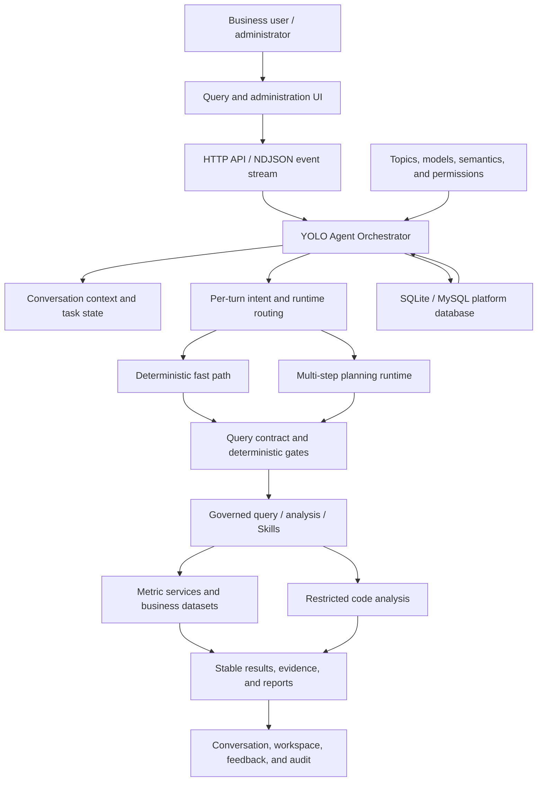
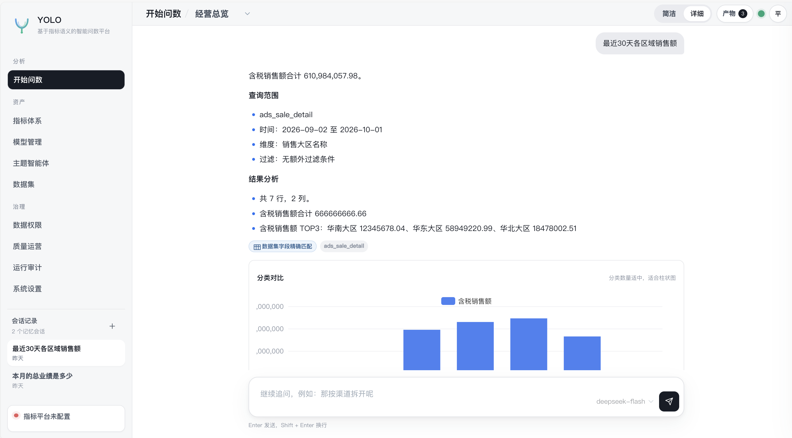
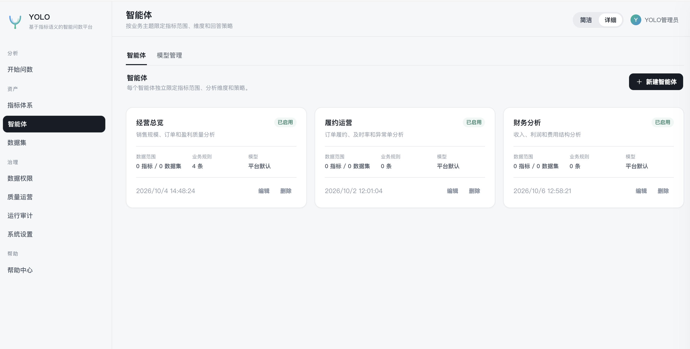

[简体中文](README.md) | English

# YOLO Data Agent | Governed Conversational Analytics

YOLO Data Agent is built for teams that need consistent business definitions, enforceable data permissions, and reviewable analytical evidence. Users ask, refine, break down, and analyze business questions in natural language. Administrators configure topics, metrics, datasets, models, Skills, and access boundaries.

The platform does not treat model-generated SQL as a trustworthy answer. Models interpret questions, propose plans, and explain results; YOLO owns context resolution, query contracts, authorization, read-only query generation, result locking, and evidence persistence.

## Design Goals

- **Make business questions executable:** translate natural language into explicit metrics, dimensions, time ranges, filters, ordering, and analytical goals.
- **Govern business meaning:** manage terminology, metric definitions, field roles, enum domains, and defaults as platform configuration rather than model guesses.
- **Control data access:** enforce topic, metric, dataset, row, and column permissions on the server.
- **Make results reviewable:** retain query contracts, plans, fingerprints, data hashes, workspace artifacts, and audit records.
- **Keep simple questions fast and complex questions decomposable:** select the execution path on every turn instead of binding an entire conversation to one compute mode.

## Design Principles

### 1. The YOLO session is the sole context authority

YOLO owns conversation messages, task state, inherited conditions, clarification decisions, permissions, and workspace references. Every turn receives a versioned context. A model or planning thread cannot independently inherit a prior metric, time range, or filter.

This lets follow-ups such as “group it by region,” “use this year,” or “only East China” continue from explicit task state instead of guessed chat history.

### 2. Contract-first: validate before accessing data

Models submit structured query intent. YOLO compiles it into a query contract and checks that:

- metrics, dimensions, and fields exist and are enabled;
- time ranges and aggregation grain are explicit;
- enum values and business rules have traceable sources;
- the user has topic, dataset, row, and column access;
- the query remains read-only, bounded, and deterministically ordered.

No data query runs until the contract passes. The platform does not substitute a similar field to manufacture an answer.

### 3. The model proposes; the platform decides

Models are useful for semantic interpretation, planning, method selection, and business communication. Deterministic code owns date calculations, permission merging, field allowlists, SQL compilation, numeric calculations, and result validation. Every numerical claim must come from a successful locked result.

### 4. Routing is decided per turn

Simple metric questions use the low-latency deterministic path. Comparisons, attribution, diagnosis, reports, and code-driven analysis can use a multi-step planning path. Routing is recalculated on every turn, so an existing planning thread never forces a later simple question onto the complex path. Fast turns are included in the canonical context when a later complex turn resumes planning.

### 5. Workflow is an execution projection, not a fixed pipeline

YOLO defines 14 standard stages as shared vocabulary for runtimes, gates, Skills, audit, and UI presentation. A question does not mechanically execute every stage. The UI displays only work that actually occurred, and Skills participate only in their relevant planning, execution, or validation phases.

### 6. Results precede narrative

YOLO creates a stable result snapshot before producing an explanation, chart, or analytical report. Follow-ups and result operations prefer the locked snapshot, reducing unnecessary re-querying and result drift.

## Architecture



### Layers

| Layer | Responsibility |
| --- | --- |
| Experience | Questions, follow-ups, clarification, charts, Markdown reports, and workspace files |
| Agent orchestration | Context resolution, per-turn routing, tools, recovery, reflection, and answer generation |
| Semantics and governance | Business vocabulary, metrics, field roles, value domains, contracts, permissions, and gates |
| Execution | Metric queries, read-only dataset queries, derived calculations, code analysis, and validation |
| Persistence | Users, topics, sessions, task state, workspaces, audit, and platform configuration |

Complex tasks can use the bundled open-source planning runtime, but it is only a replaceable component in the orchestration layer. YOLO continues to own conversation context, query contracts, authorization, and result evidence.

## Query Lifecycle

```text
User question
  → load the YOLO session, long-term memory, and topic configuration
  → classify a new question, follow-up, result operation, or clarification
  → select the deterministic or multi-step planning path
  → resolve metrics, dimensions, time, and business filters
  → compile and validate the query contract
  → execute read-only queries or analysis through governed tools
  → lock the result and produce a chart, answer, or analytical report
  → persist task state, workspace artifacts, and audit evidence
```

Query execution, recovery, and post-answer reflection share a per-session lock so concurrent requests cannot interleave messages, task state, or workspace writes.

## Core Capabilities

- **Business DataAgents:** independently configure prompts, models, Skills, metrics, datasets, defaults, and example questions for each topic.
- **Metrics and datasets:** connect metric catalogs and MySQL, TiDB, Doris, or PostgreSQL business data.
- **Field semantics:** manage business names, roles, aggregations, value domains, aliases, default time fields, and enabled state.
- **Continuous analysis:** support follow-ups, grouping, ranking, trends, period comparison, shares, derived metrics, attribution, and opportunity analysis.
- **Reports and workspaces:** retain query results, Markdown reports, charts, CSV, JSON, XLSX, and code-generated artifacts.
- **Permissions:** enforce topic, metric, and dataset grants plus row filtering and column hiding or masking.
- **Skills and MCP:** extend planning guidance, validation, and external query access without bypassing contracts or permissions.
- **Observability:** record dynamic workflow stages, tool calls, model calls, tokens, query plans, errors, feedback, and knowledge gaps.
- **Recovery:** apply bounded retry and strategy replanning to recoverable failures while stopping immediately for cancellation or permission errors.

## Screenshots






## Quick Start

### Requirements

- Node.js `>= 22.5`
- npm or pnpm
- Python `3.11+` for advanced analysis and file generation
- SQLite or MySQL for platform state
- At least one Responses API-compatible model service

### Linux

```bash
git clone https://github.com/xiaour/yolo-data.git yolo-data
cd yolo-data
bash start.sh
```

### Windows PowerShell

```powershell
git clone https://github.com/xiaour/yolo-data.git yolo-data
cd yolo-data
.\start.ps1
```

The launcher guides first-time dependency and platform database initialization. Later runs start the service directly. Open [http://localhost:8088/](http://localhost:8088/) by default.

### Docker Compose

```bash
docker compose up -d --build
```

Change the default password after the first login. Public deployments must use `AUTH_MODE=session` behind an HTTPS reverse proxy.

## Initial Configuration

1. Add a Responses API-compatible model and select the platform or topic default.
2. Connect a metric service, or create a business data source and synchronize dataset fields.
3. Confirm field roles, business names, aggregations, default time fields, and value domains.
4. Configure a DataAgent with its model, data scope, Skills, and topic prompt.
5. Grant users access and row or column policies, then verify results with a business account.

## Configuration Rules

- `yolo-conf.yaml` contains shareable platform structure and defaults with bilingual comments.
- `.env` stores machine-local database passwords, model keys, and other secrets and must not be committed.
- Precedence is process environment > `.env` > `yolo-conf.yaml` > built-in defaults.
- Model services must expose `/responses`; Completions and Chat Completions are not used.
- Business rules belong in topic semantics, dataset field descriptions, and value-domain configuration, not hard-coded platform logic.

See [`.env.example`](.env.example) for common variables and [`yolo-conf.yaml`](yolo-conf.yaml) for complete configuration descriptions.

## Security and Production Deployment

- Models never receive database credentials, physical connections, or arbitrary SQL execution access.
- YOLO generates read-only SQL and enforces field allowlists, row limits, and permissions.
- Row policies are merged during query execution; column policies are applied before result delivery.
- Uploaded content is sanitized for prompt injection before entering model context.
- Keep API keys and database passwords in `.env` or real process environment variables.
- `SANDBOX_BACKEND=inprocess` is not a security boundary. Use Docker or Podman with no network and a read-only root filesystem for untrusted or multi-tenant environments.
- SQLite suits single-node deployments. Multi-instance deployments should use the MySQL platform store and shared locking, file storage, and audit infrastructure.
- Change default credentials, enable session authentication, and configure HTTPS before public exposure.

## API Example

```bash
curl -N -X POST http://localhost:8088/api/chat/query/stream \
  -H 'Content-Type: application/json' \
  -b cookie.txt \
  -d '{
    "themeId": 1,
    "question": "Which customers declined most year over year, and where are the opportunities?"
  }'
```

## Documentation

- [System architecture](docs/architecture.md)
- [Long-term memory architecture](docs/memory-architecture.md)
- [Skill upload and acceptance](docs/skill-upload.md)
- [PostgreSQL integration](docs/postgresql.md)
- [MCP connector](mcp-connector/README.md)
- [Demo data](config/demo/README.md)

## Contributing

- Keep business-specific vocabulary, mappings, and formulas out of platform core code.
- Preserve contract-first execution, mandatory permissions, and evidence boundaries.
- Add tests and evaluation cases for new features and regressions.
- Continue splitting registered large files instead of silently raising size baselines.

## License

Apache License 2.0. See [LICENSE](LICENSE).
